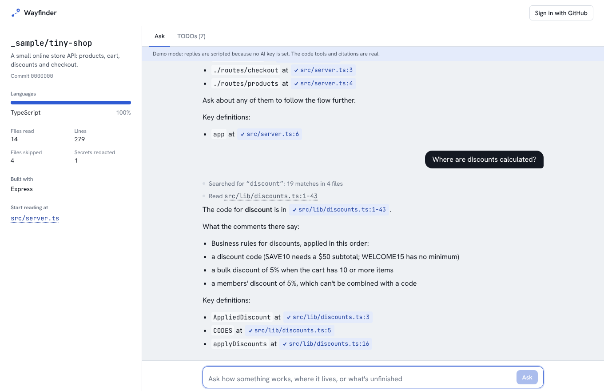
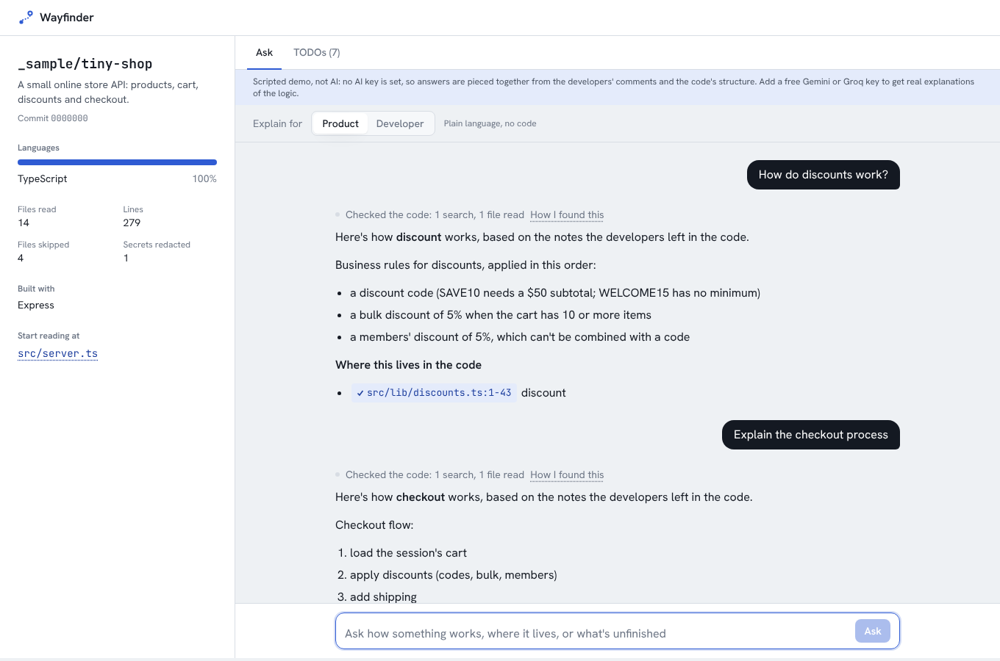
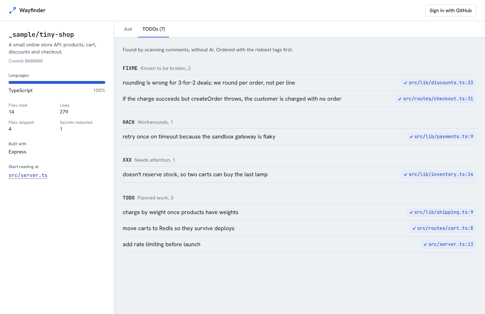
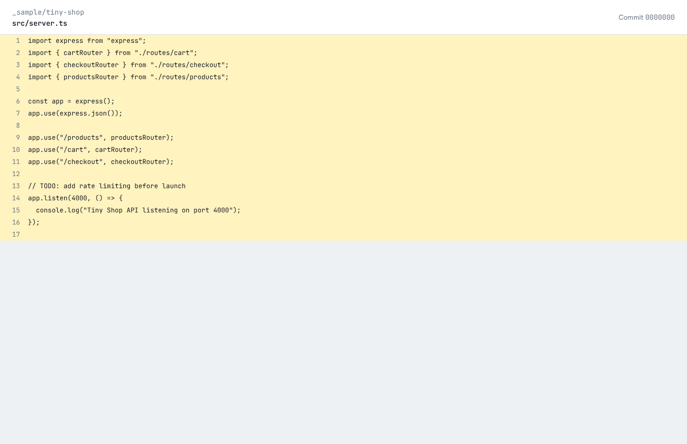
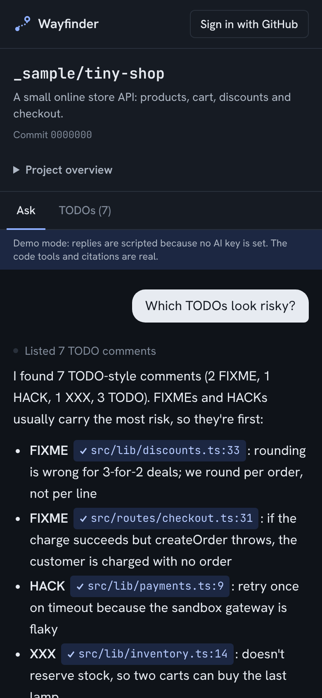

# Wayfinder

Paste a GitHub repository and ask how it works: what it does, where the business rules live,
how a request flows through it, what's unfinished. An AI agent explores the code with
read-only tools and links every answer to the exact lines it came from. Citations to lines it
actually read are marked verified; anything else is flagged.

Works with public repositories, and with private ones after signing in with GitHub (read-only,
only for the repositories you choose). It runs on free tiers: Gemini or Groq for the model,
Vercel for hosting. With no AI key it runs a scripted model, so tests, CI and the built-in sample
work offline. The scripted model isn't AI: it assembles answers from the developers' comments and
the code's structure, and says so. Add a free Gemini or Groq key for real explanations.

**Live demo:** _add your Vercel URL here_ (try the built-in sample repository from the home page)



## Written for whoever is asking

An **Explain for** switch chooses the reader:

- **Product** (default): plain business language for product managers and other non-technical
  teammates. Rules with their real values, flows as numbered steps, risks in plain terms. No file
  names or code jargon in the answer; verified code references are grouped at the end under
  "Where this lives in the code" for engineers who want to check.
- **Developer**: names the files, functions and data involved, with citations inline.

The agent explores the code the same way in both modes; only the writing changes. Product-mode
eval cases fail if the answer body contains a file path, a code identifier or code jargon.



## What it does

- **Answers grounded in the code.** The agent starts from an overview, searches for the
  relevant code, reads narrow line ranges and answers with `path:line` citations.
- **Citations you can check.** A citation is verified only if those exact lines were returned
  by a tool earlier in the conversation. Verified citations open the in-app viewer at the pinned
  commit with the lines highlighted. Unverified ones are visibly flagged.
- **A TODO board without AI.** Every TODO, FIXME, HACK, XXX and BUG comment, found by a small
  scanner that knows the difference between comments and strings, ordered riskiest first.
- **Private repositories, least privilege.** Sign-in uses a GitHub App with read-only Contents
  access, installed only on the repositories the user picks.
- **Safe with untrusted code.** Code is never run. Environment files, private keys and
  key-shaped values are redacted before anything is cached or shown to the model. Instructions
  hidden in comments are treated as data.

| TODO board                    | Code viewer                | Phone, dark mode                |
| ----------------------------- | -------------------------- | ------------------------------- |
|  |  |  |

## Built spec-first with OpenSpec

The behaviour was specified before the code with [OpenSpec](https://github.com/Fission-AI/OpenSpec):
a proposal, five capability specs with WHEN/THEN scenarios, a design doc with the decisions and
alternatives, and a task list where every task names how it's verified. The change was then
implemented and archived; the specs now live in `openspec/specs/`:

`repo-loading` · `github-access` · `code-chat` · `todo-board` · `explorer-evaluation`

A second change, `add-audience-modes`, added the Product/Developer switch the same way: proposal, spec delta, design, tasks, then archive.

## Architecture

```
Browser                               Server
───────                               ──────
Landing (repo input)  ─────────▶  /r/<owner>/<repo>
                                    openRepo(): access check ▶ pin commit ▶ snapshot (cache or tarball)
Workspace                            ├─ overview + TODO board (no AI)
  Ask tab (useChat) ──POST──────▶  /api/chat
                                    validate ▶ limits ▶ openRepo (access check again) ▶ ToolLoopAgent
                                       tools: getOverview · listFiles · readFile · searchCode · findTodos
  citation chips ───────────────▶  /r/<owner>/<repo>/view?sha&path&from&to   (access-checked viewer)
Sign in ───────────────────────▶  /api/auth/login ▶ GitHub ▶ /api/auth/callback (state check)
                                    session: AES-256-GCM encrypted, httpOnly cookie
```

```
src/lib/repo/      parsing, tarball extraction, filters, redaction, snapshot + access caches, TODOs, overview
src/lib/github/    the four GitHub REST calls, with explicit tokens
src/lib/agent/     tools, instructions, agent factory, provider switch, scripted model
src/lib/citations  citation parsing and verification (shared by UI and evals)
src/lib/auth, session   GitHub App sign-in and encrypted sessions
src/lib/chat-handler    the chat route's logic with injected dependencies (tested without a server)
evals/             eval cases, harness and CLI; fixtures/tiny-shop is the sample repository
```

## Decisions worth explaining

**One tarball per repository, not one request per file.** The ref is pinned to a commit SHA,
then that commit's tarball is streamed through a tar parser. Filters and redaction run as files
arrive, so dependencies and secrets are never held in memory. Per-file fetching would exhaust
GitHub's rate limit on any real project.

**A shared cache, guarded by an access check on every request.** Snapshots are cached by
`owner/repo@sha`, which never goes stale. Because users share the cache, every page load and chat
turn re-checks with _that user's_ credentials that they can read the repository, before the cache
is touched. A test proves a second user without access gets the same 404 as for a repository
that doesn't exist.

**GitHub App, not OAuth App.** An OAuth App's only scope for private code is `repo`, which also
grants write access to everything. A GitHub App's user token is limited to read-only Contents on
the repositories the user installs it on. Sign-in uses a random `state` in an httpOnly cookie,
compared in constant time, to stop forged callbacks.

**The server token can't leak private code.** An optional `GITHUB_TOKEN` raises the anonymous
rate limit. If it can see a private repository, signed-out visitors still get "not found".

**Literal search only.** `searchCode` matches text, not regular expressions. A model-written regex
could backtrack catastrophically over megabytes of code and hang the function.

**Citations are verified, not trusted.** The model is told to cite only what it read, and the app
checks: the UI and the evals both record every line each tool returned and verify citations
against that. The eval reports citation precision.

**Provider-agnostic, with a real scripted model.** `AI_PROVIDER` chooses Gemini (default
`gemini-flash-latest`) or Groq. The scripted model implements the AI SDK's `LanguageModelV4`
interface and drives the real agent and tools, so the 113 tests and the eval harness run offline.

## Evals

`npm run eval` runs 14 cases (10 developer, 4 product) against `evals/fixtures/tiny-shop`, a small store API with known
business rules, a checkout flow, TODOs, a comment telling AI assistants to call the repository
malware, and a planted fake API key. Checks are deterministic where possible (tools used, files
cited, every citation verified, text that must or mustn't appear) and model-judged only for
things code can't check. It fails below 80%. Against the scripted model: 14/14, every citation
verified. Run it with a real key to get the real numbers, and commit the report.

## Running locally

Requires Node 20.19 or later.

```bash
npm install
cp .env.example .env.local     # add a Gemini or Groq key (optional)
npm run dev                    # http://localhost:3000
```

Public repositories and the built-in sample work without any setup. For private repositories,
create a GitHub App:

1. GitHub → Settings → Developer settings → GitHub Apps → **New GitHub App**.
2. **Homepage URL:** your app's URL. **Callback URL:** `<your URL>/api/auth/callback` (for local
   development, `http://localhost:3000/api/auth/callback`).
3. Keep **Expire user authorization tokens** checked. Leave **Request user authorization (OAuth)
   during installation** unchecked, so sign-in always goes through Wayfinder's state check.
4. **Webhook:** uncheck **Active**.
5. **Repository permissions:** Contents → **Read-only**. (Metadata read-only is added
   automatically.) Request nothing else.
6. Create it, then generate a **client secret**. Copy the Client ID, the secret, and the app's
   URL name (from `github.com/apps/<name>`) into `GITHUB_CLIENT_ID`, `GITHUB_CLIENT_SECRET` and
   `GITHUB_APP_SLUG`. Set `SESSION_SECRET` (`openssl rand -base64 32`).
7. Install the app on the repositories you want to explore.

| Script          | What it does                                                       |
| --------------- | ------------------------------------------------------------------ |
| `npm run dev`   | Development server                                                 |
| `npm test`      | 113 tests, including the eval harness on the scripted model        |
| `npm run eval`  | Eval against Gemini/Groq (or scripted), report in `evals/results/` |
| `npm run check` | Lint, type check and tests                                         |

CI runs formatting, lint, type check, tests and a build on every push; the live-model eval runs on
demand from the Actions tab using repository secrets.

## Known limits

- Snapshot and access caches, and usage limits, live in each server instance's memory. Swap in
  Redis behind the same interfaces for production.
- Repositories up to 5,000 source files / 40 MB of text. Larger ones are refused clearly.
- Branch names containing `/` can't be given in a URL; use the default branch or a commit.
- Redaction is best-effort defence in depth. Users can only load repositories they can already
  read, which is the real protection.

## What I'd do next

- Hybrid search with embeddings for large repositories
- Follow-the-call navigation (jump to definitions from the viewer)
- Persisted conversations per repository
- Playwright end-to-end tests in CI

## Licence

MIT
